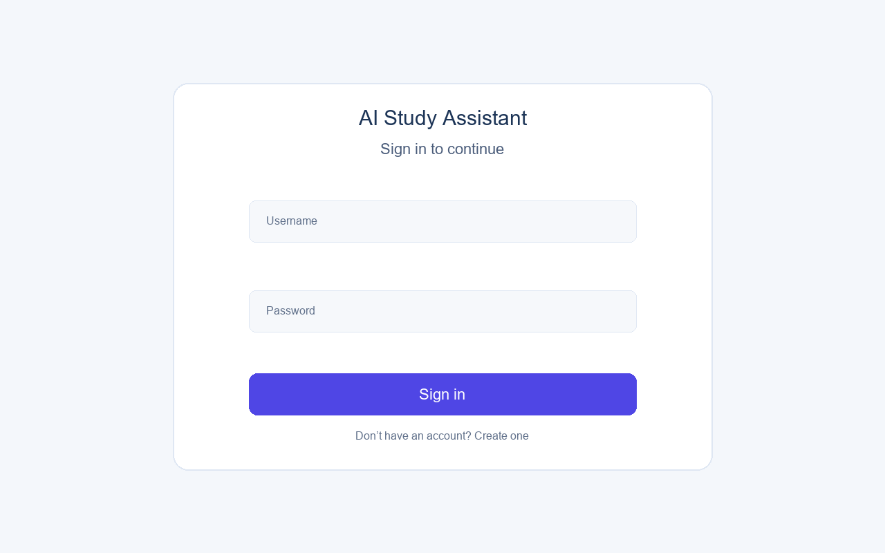
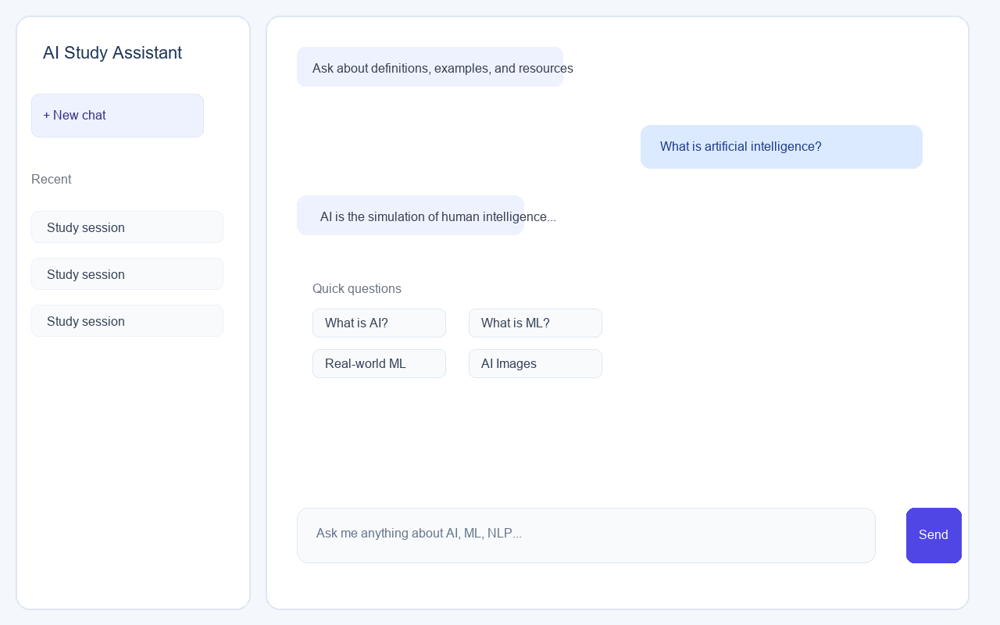
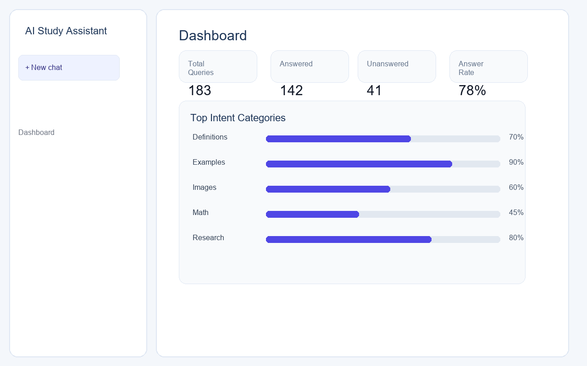

# AI Study Assistant

AI Study Assistant is an intelligent chatbot and study companion built with FastAPI, SQLAlchemy, and a lightweight frontend. It can answer general questions, support study workflows, and provide quick analytics for user activity.

## Features

- Conversational AI chat interface
- User authentication and session tracking
- Study dashboard with usage insights
- Intent-aware question handling
- Responsive web frontend
- Python backend with FastAPI

## Screenshots

### Login screen


### Chat interface


### Dashboard


## Tech Stack

- Backend: Python, FastAPI, SQLAlchemy
- Frontend: HTML, CSS, JavaScript
- Data handling: JSON datasets and lightweight analytics
- Authentication: JWT-based login

## Local setup

1. Create and activate a virtual environment:
   ```bash
   python -m venv .venv
   .venv\Scripts\activate
   ```
2. Install dependencies:
   ```bash
   pip install -r requirements.txt
   ```
3. Start the backend:
   ```bash
   uvicorn backend.app.main:app --reload
   ```
4. Open the frontend files in a browser, or serve them through your local web server.

## Project structure

```text
backend/
  app/
  data/
  test_*.py
frontend/
requirements.txt
README.md
```

## Notes

This project is designed for local development and demo use. For production deployment, consider adding environment variables, secure secret management, and deployment configuration for the frontend and backend.
